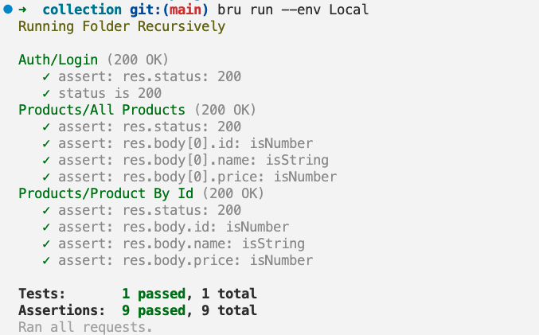

# Marrone CLI

With Marrone CLI, you can now run your API collections with ease using simple command line commands.

This makes it easier to test your APIs in different environments, automate your testing process, and integrate your API tests with your continuous integration and deployment workflows.

For detailed documentation, visit the [Marrone wiki](https://github.com/ThiagoGomesRocha/Marrone/wiki). It links to the [Bruno docs](https://docs.usebruno.com), which remains the reference for the collection format, scripting, runner and CLI options.

## Installation

To install the Marrone CLI, use the node package manager of your choice, such as NPM:

```bash
npm install -g @marrone/cli
```

## Getting started

Navigate to the directory where your API collection resides, and then run:

```bash
marrone run
```

This command will run all the requests in your collection. You can also run a single request by specifying its filename:

```bash
marrone run request.bru
```

Or run all requests in a collection's subfolder:

```bash
marrone run folder
```

If you need to use an environment, you can specify it with the `--env` option:

```bash
marrone run folder --env Local
```

If you need to collect the results of your API tests, you can specify the `--output` option:

```bash
marrone run folder --output results.json
```

If you need to run a set of requests that connect to peers with both publicly and privately signed certificates respectively, you can add private CA certificates via the `--cacert` option. By default, these certificates will be used in addition to the default truststore:

```bash
marrone run folder --cacert myCustomCA.pem
```

If you need to limit the trusted CA to a specified set when validating the request peer, provide them via `--cacert` and in addition use `--ignore-truststore` to disable the default truststore:

```bash
marrone run request.bru --cacert myCustomCA.pem --ignore-truststore
```

## Importing Collections

You can import collections from other formats, such as OpenAPI, using the import command:

```bash
marrone import openapi --source api.yml --output ~/Desktop/my-collection --collection-name "My API"
```

You can also use the shorter form with aliases:

```bash
marrone import openapi -s api.yml -o ~/Desktop/my-collection -n "My API"
```

This creates a Marrone collection directory that can be opened in Marrone.

You can also import directly from a URL:

```bash
marrone import openapi --source https://example.com/api-spec.json --output ~/Desktop --collection-name "Remote API"
```

You can also export the collection as a JSON file:

```bash
marrone import openapi --source api.yml --output-file ~/Desktop/my-collection.json --collection-name "My API"
```

Import Options:

| Option                    | Details                                            |
| ------------------------- | -------------------------------------------------- |
| --source, -s              | Path to the source file or URL (required)          |
| --output, -o              | Path to the output directory                       |
| --output-file, -f         | Path to the output JSON file                       |
| --collection-name, -n     | Name for the imported collection                   |
| --insecure                | Skip SSL certificate validation when fetching from URLs |

## Command Line Options

| Option                       | Details                                                                       |
| ---------------------------- | ----------------------------------------------------------------------------- |
| -h, --help                   | Show help                                                                     |
| --version                    | Show version number                                                           |
| -r                           | Indicates a recursive run (default: false)                                    |
| --cacert [string]            | CA certificate to verify peer against                                         |
| --env [string]               | Specify environment to run with                                               |
| --env-var [string]           | Overwrite a single environment variable, multiple usages possible             |
| -o, --output [string]        | Path to write file results to                                                 |
| -f, --format [string]        | Format of the file results; available formats are "json" (default) or "junit" |
| --reporter-json [string]     | Path to generate a JSON report                                                |
| --reporter-junit [string]    | Path to generate a JUnit report                                               |
| --reporter-html [string]     | Path to generate an HTML report                                               |
| --insecure                   | Allow insecure server connections                                             |
| --tests-only                 | Only run requests that have tests                                             |
| --bail                       | Stop execution after a failure of a request, test, or assertion               |
| --csv-file-path              | CSV file to run the collection with                                           |
| --reporter--skip-all-headers | Skip all headers in the report                                                |
| --reporter-skip-headers      | Skip specific headers in the report                                           |
| --client-cert-config         | Client certificate configuration by passing a JSON file                       |
| --delay [number]             | Add delay to each request                                                     |

## Scripting

Marrone cli returns the following exit status codes:

- `0` -- execution successful
- `1` -- an assertion, test, or request in the executed collection failed
- `2` -- the specified output directory does not exist
- `3` -- the request chain seems to loop endlessly
- `4` -- bru was called outside of a collection root directory
- `5` -- the specified input file does not exist
- `6` -- the specified environment does not exist
- `7` -- the environment override was not a string or object
- `8` -- an environment override is malformed
- `9` -- an invalid output format was requested
- `255` -- another error occurred

## Demo



## Support

If you encounter any issues or have any feedback or suggestions, please raise them on our [GitHub repository](https://github.com/ThiagoGomesRocha/Marrone)

Thank you for using Marrone CLI!

## Changelog

<!-- An absolute link is used here because npm treats links differently -->

See [https://github.com/ThiagoGomesRocha/Marrone/releases](https://github.com/ThiagoGomesRocha/Marrone/releases)

## License

[MIT](license.md)
